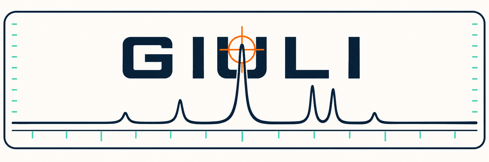

<p align="center">
  <picture>
    <source
      media="(prefers-color-scheme: dark)"
      srcset="assets/branding/readme-header.png"
    >
    <source
      media="(prefers-color-scheme: light)"
      srcset="assets/branding/readme-header-light.png"
    >
    
  </picture>
</p>

<p align="center">
  <a href="https://github.com/EXCI5ION/giuli-nmr/releases/latest">
    
  </a>
  <a href="https://doi.org/10.5281/zenodo.23147218">
    
  </a>
</p>

GIULI es un programa de código abierto para el procesamiento interactivo y
reproducible de espectros de RMN, orientado inicialmente a experimentos
Bruker 1D y a flujos de trabajo de metabolómica.

Está dirigido a investigadores, estudiantes y laboratorios que necesiten
procesar, comparar, alinear, integrar y exportar conjuntos de espectros sin
depender de software propietario para todo el flujo de análisis.

Versión actual: **1.1.0**.

## Descargar para Windows

[Descargar el instalador de GIULI 1.1.0 para Windows (64 bits)](https://github.com/EXCI5ION/giuli-nmr/releases/download/v1.1.0/GIULI-1.1.0-windows-x64.exe)

También puedes consultar la [última versión publicada](https://github.com/EXCI5ION/giuli-nmr/releases/latest)
y sus notas de lanzamiento.

## Instalación desde el código fuente

GIULI admite **Python 3.12 o 3.13**. Existen instaladores automatizados para
Windows, Debian/Ubuntu y macOS; la instalación local desde el código fuente se
mantiene como alternativa.

### Windows (PowerShell)

En Windows x64 y ARM64 puede utilizarse el instalador automatizado con una
instalación de Python 3.12 o 3.13:

```powershell
Invoke-WebRequest `
  https://github.com/EXCI5ION/giuli-nmr/releases/latest/download/install_windows.py `
  -OutFile "$env:TEMP\install_windows.py"
py -3.13 "$env:TEMP\install_windows.py"
```

La instalación se realiza por usuario, no requiere Git ni privilegios de
administrador y añade accesos directos junto con los comandos `giuli`,
`giuli-update` y `giuli-uninstall`.

### Windows desde el código fuente (Git Bash)

```bash
git clone https://github.com/EXCI5ION/giuli-nmr.git
cd giuli-nmr
py -3.12 -m venv .venv
./.venv/Scripts/python.exe -m pip install --upgrade pip
./.venv/Scripts/python.exe -m pip install .
./.venv/Scripts/giuli.exe
```

### Linux

En Debian 13, Ubuntu 24.04 y derivados compatibles con APT puede
utilizarse el instalador global:

```bash
git clone https://github.com/EXCI5ION/giuli-nmr.git
cd giuli-nmr
python3 packaging/linux/install_linux.py
```

El instalador comprueba Python 3.12/3.13, crea un entorno aislado y añade los
comandos globales:

```bash
giuli
giuli-update
```

Como alternativa, puede realizarse una instalación local sin comandos globales:

```bash
python3 -m venv .venv
./.venv/bin/python -m pip install --upgrade pip
./.venv/bin/python -m pip install .
./.venv/bin/giuli
```

### macOS

El instalador admite macOS 13 o posterior en Macs Intel y Apple
Silicon. Necesita
una cuenta administradora y las herramientas de línea de comandos de Apple; si
no están instaladas, macOS permite obtenerlas con `xcode-select --install`.

```bash
git clone https://github.com/EXCI5ION/giuli-nmr.git
cd giuli-nmr
python3 packaging/macos/install_macos.py
```

El instalador detecta `arm64` o `x86_64`, rechaza la ejecución mediante Rosetta,
crea un runtime privado y añade `GIULI.app` junto con los comandos:

```bash
giuli
sudo giuli-update
sudo giuli-uninstall
```

## Funcionalidades

En su versión actual, GIULI permite:

- Cargar conjuntos de datos Bruker 1D desde sus FID y procesarlos utilizando
  los parámetros compatibles almacenados en `procs`, incluido `SI`.
- Realizar correcciones de fase y línea de base, manuales y automáticas.
- Referenciar, visualizar, apilar y superponer espectros.
- Alinear conjuntos de forma global, automática o manual por regiones.
- Definir zonas ciegas y plantillas reutilizables de regiones.
- Normalizar por área total, pico máximo o PQN.
- Calcular integrales absolutas y relativas de conjuntos espectrales.
- Deconvolucionar manualmente señales solapadas en conjuntos apilados y exportar
  sus contribuciones junto con la tabla general de integrales.
- Exportar matrices espectrales e integrales en formato CSV o texto tabulado.
- Guardar el trabajo en proyectos comprimidos con extensión `.giu`.

## Documentación

- [Manual de usuario 1.1.0](docs/pdf/GIULI-manual-de-usuario-versión1.1.0.pdf)
- [Documentación científica 1.1.0 en PDF](docs/pdf/GIULI-documentacion-cientifica-versión1.1.0.pdf)
- [Documentación científica en Markdown](docs/SCIENTIFIC_DOCUMENTATION.md)
- [Referencia rápida](docs/QUICK_REFERENCE.md)
- [Índice completo](docs/README.md)

## Cómo citar

Los metadatos de citación de GIULI se encuentran en [`CITATION.cff`](CITATION.cff).
GitHub permite obtener desde ese archivo una referencia en formatos APA y BibTeX.
Para citar GIULI 1.1.0 utiliza el
[DOI 10.5281/zenodo.24103526](https://doi.org/10.5281/zenodo.24103526).
El [DOI conceptual](https://doi.org/10.5281/zenodo.23147218) reúne todas las
versiones publicadas de GIULI.

## Licencia

Copyright (C) 2026 Gabriel Anderson.

GIULI es software libre distribuido bajo la
[GNU General Public License, versión 3](LICENSE) (`GPL-3.0-only`). Los componentes
de terceros conservan sus propias licencias; consulta
[`THIRD_PARTY_NOTICES.md`](THIRD_PARTY_NOTICES.md).
